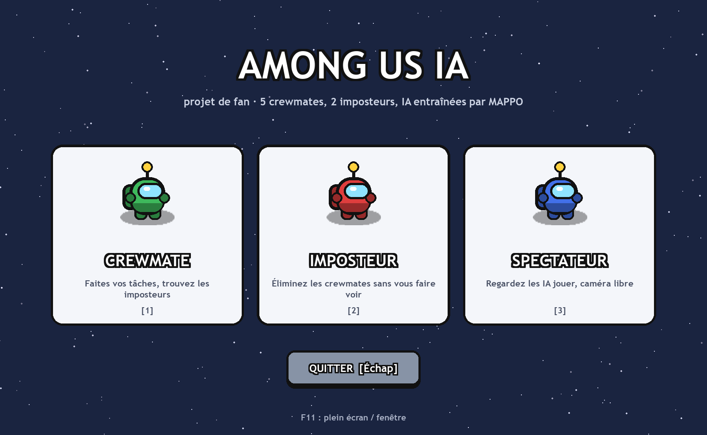
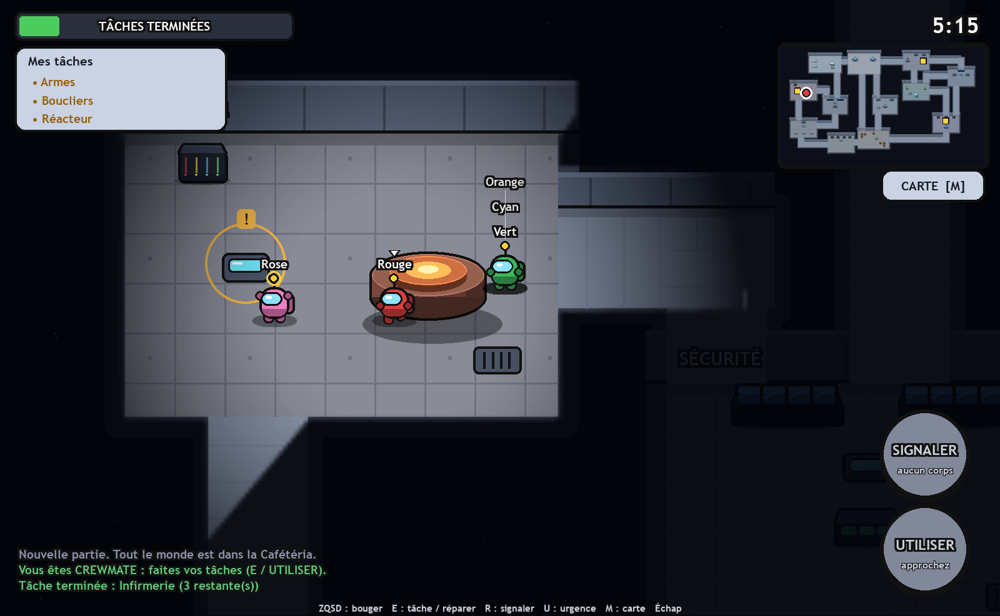
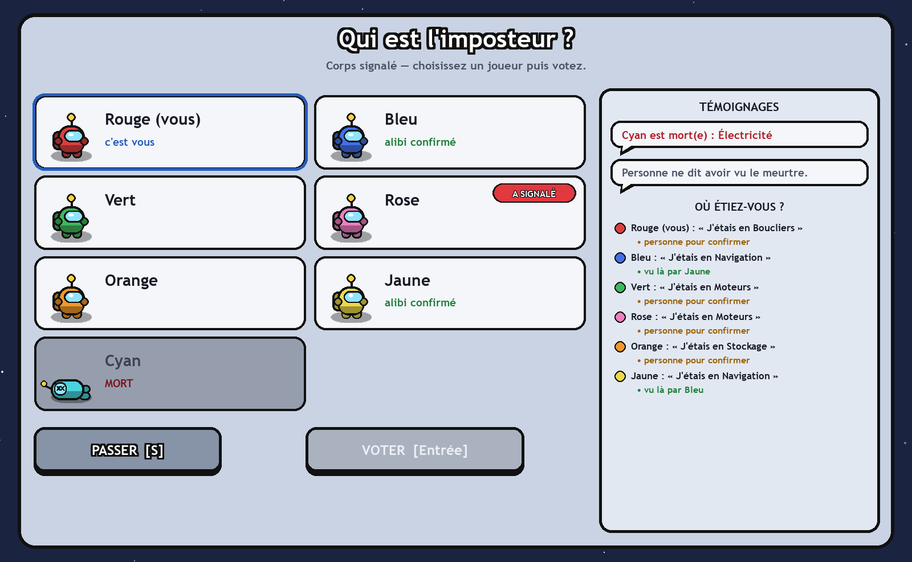
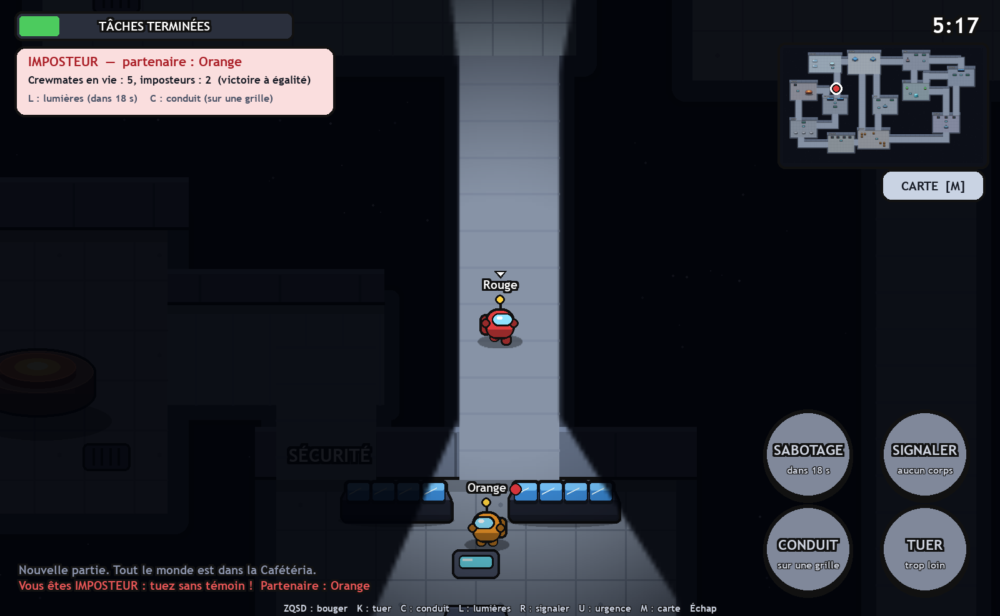
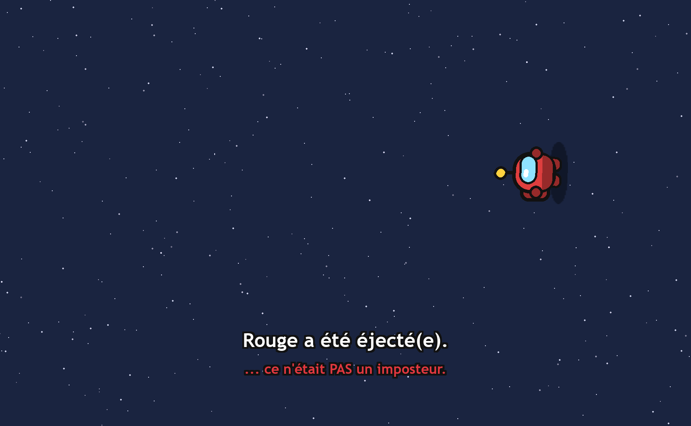
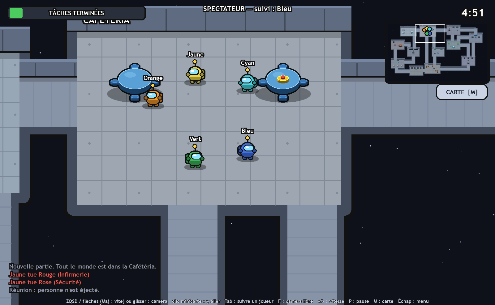

# Among Us simplifié — IA multi-agents MAPPO (temps réel)

Jeu inspiré d'Among Us (designs originaux, rendu 2.5D, déplacement libre en temps réel) où **5 crewmates IA et 2 imposteurs IA**
sont entraînés par **MAPPO** (Multi-Agent PPO, entraînement centralisé / exécution décentralisée). Tu peux aussi jouer toi-même.

> Projet de fan, non commercial, sans lien avec Innersloth. « Among Us » est une marque d'Innersloth LLC ; ce dépôt
> n'en reprend aucun élément graphique ni sonore.

| | |
|---|---|
|  |  |
|  |  |
|  |  |

## Installation
```bash
pip install -r requirements.txt      # numpy + pygame suffisent pour JOUER ; torch + matplotlib pour ENTRAÎNER
```

## Jouer
```bash
python play.py                       # plein écran, menu : crewmate, imposteur ou spectateur (modèle : models/mappo.npz)
python play.py --role crew           # directement en crewmate (--role imposter : en imposteur)
python play.py --spectate            # 7 IA, tu regardes avec une caméra libre (voir ci-dessous)
python play.py --windowed            # en fenêtre ; F11 bascule plein écran / fenêtre
python play.py --crew-ai scripted    # change l'IA : mappo | scripted | random   (--imp-ai : + prudent)
python play.py --greedy              # IA déterministes (par défaut elles tirent leur action dans leur politique)
python play.py --players 6+2         # autre nombre de joueurs (le modèle fourni est entraîné en 5+2)
```
Spectateur : `ZQSD`/flèches (Maj : plus vite) ou glisser à la souris pour déplacer la caméra, clic sur la
minicarte ou la grande carte (`M`) pour y aller, `Tab` suivre un joueur, `F` revenir en caméra libre, `+`/`-` vitesse,
`P` pause, `Échap` menu.
Contrôles en jeu : `ZQSD`/flèches bouger · `E`/Espace (maintenu) faire une tâche ou réparer les lumières · `K` tuer ·
`C` conduit (imposteur, sur une grille) · `L` couper les lumières (imposteur) · `R` signaler un corps (l'imposteur aussi) ·
`U` réunion d'urgence (dans la Cafétéria, une fois par partie) · `M` carte · `V` vue complète (debug) · `Échap`.
Les réunions ont leur écran dédié : qui est mort, accusations, « où étiez-vous ? » et ce qu'en disent les autres, vote,
dépouillement animé, éjection. En imposteur, vous choisissez d'abord ce que vous déclarez (salle, et accusation éventuelle).

## Entraîner (sur ton PC)
En deux étapes : d'abord les déplacements (vote et déclarations par règles), puis le vote et les déclarations appris.
```bash
python train_mappo.py --iters 1500 --games 128 --vote scripted --players 5+2 --out runs/v5a
python train_mappo.py --iters 800 --games 128 --players 5+2 --out runs/v5b --init runs/v5a/latest.pt --vote-pretrain 3000 --vote-warmup 20
# affinage après un changement de règle (ici : tâches plus courtes et mieux récompensées)
python train_mappo.py --iters 300 --games 128 --players 5+2 --out runs/v5c --init runs/v5b/latest.pt --ent 0.01 --ent-end 0.003 --lr 2e-4 --lr-end 1e-4
```
- **Reprise** après interruption : relance la même commande avec `--resume` (état complet dans `runs/<nom>/latest.pt`).
- `--workers N` : processus de collecte de parties (défaut : cœurs − 1). **C'est le goulot d'étranglement** (le simulateur
  tourne sur CPU) : plus tu as de cœurs, plus ça va vite. Essaie `--games 256` avec 8+ cœurs.
- `--device auto` : la mise à jour PPO utilise le GPU CUDA s'il est disponible (RTX 2060 : oui, installe la version CUDA de
  PyTorch). Gain modeste, la mise à jour ne représente que ~20 % du temps d'une itération.
- Autres options : `--hidden 128` (taille des réseaux), `--lr`, `--lr-end`, `--ent`, `--ent-end`, `--eval-every`, `--snap-every`.
- Sorties dans `runs/<nom>/` : `latest.npz` (acteurs, c'est ce que lit le jeu), `ckpt_XXXX.npz` tous les 25 itérations,
  `log.csv` (courbes). Pour jouer avec le résultat : `cp runs/v5b/latest.npz models/mappo.npz`.
- Le modèle fourni dans `models/mappo.npz` contient les réseaux de déplacement, de vote et de déclaration (voir Résultats).
  Un modèle d'une ancienne version du jeu (autres observations) est refusé avec un message clair.
```bash
python plot_training.py runs/v5b         # results/training_curves_v5b.png
python evaluate_mappo.py --n 200         # results/evaluation.md (matrice équipes × imposteurs, IC 95 %)
python analyze.py elo runs/v5a runs/v5b  # classement Elo des checkpoints (les deux camps progressent-ils vraiment ?)
python analyze.py behavior runs/v5b/latest.npz   # conduits, sabotages, mensonges, réunions : comment jouent les IA
python -m unittest discover -s tests     # 75 tests (règles, IA, affichage sans fenêtre)
python tools_measure.py models/mappo.npz 660     # qui appelle les urgences, et ce qu'elles donnent ; fins de partie
python tools_endgame.py models/mappo.npz 660     # parties qui démarrent en fin de partie : qui gagne, en combien de temps
python tools_balance.py models/mappo.npz 440 base "kill_cooldown_s=6"   # équilibre selon un réglage des règles
python tools_ablation.py models/mappo.npz 440    # quels indices le vote des crewmates utilise-t-il ?
python tools_crossplay.py models/previous/mappo_v5c.npz models/mappo.npz   # ancien modèle contre nouveau
python tools_screenshots.py docs                 # captures d'écran du README (sans fenêtre)
```

### Options de l'étape 2 (vote et déclarations appris)
- `--vote-pretrain N` : joue N parties avec le vote heuristique et apprend au réseau de vote des crewmates, en
  supervisé, à désigner l'imposteur. **Indispensable** : parti de zéro, le vote apprend à toujours passer (voter au
  hasard coûte cher, donc il renonce avant d'avoir appris à repérer l'imposteur). PPO apprend ensuite quand voter.
- `--init` reprend les réseaux de déplacement d'un autre run et repart de l'itération 0 dans un nouveau dossier.
- `--vote-warmup N` : pendant N itérations seuls les réseaux de vote apprennent (un vote encore aléatoire éjecte des
  innocents ; sans échauffement il dégraderait d'abord les réseaux de déplacement).
- `--vote scripted` : votes et déclarations par règles (étape 1).
- `--players 5+2` : nombre de crewmates et d'imposteurs (aussi via la variable `AMONG_PLAYERS`). Les réseaux ont la
  même taille de 7 à 10 joueurs (observations complétées jusqu'à 10), mais un modèle n'est bon que dans la
  configuration où il a été entraîné.
- Un modèle `.npz` sans réseau de vote ou de déclaration reste utilisable : le jeu retombe sur les règles.
- Les réglages de valeurs (`RTConfig`, `Config` : recharge, vision, mémoire, tâches...) ne changent pas la taille des
  réseaux : on les ajuste en affinant un modèle existant avec `--init` (quelques centaines d'itérations), sans tout
  réentraîner.

## Comment ça marche
**Règles (proches du vrai jeu : 5 crewmates, 2 imposteurs)**
- Vaisseau continu (12 salles + couloirs, collisions, vision par raycast), kill avec portée et recharge (7 s).
- **Tâches** : 4 par crewmate, 5 s chacune. Avec 5 tâches de 8 s, la victoire par les tâches était hors de portée
  (4 % des parties IA contre IA) et les crewmates IA ne s'en occupaient presque pas.
- **Deux imposteurs** : ils se connaissent, ne peuvent pas se tuer ni voter ou s'accuser l'un l'autre, et ont chacun
  leur recharge. Quand l'un est éjecté, l'autre continue seul.
- **Victoire** : crewmates si toutes les tâches des vivants sont faites ou si les deux imposteurs sont éjectés ;
  imposteurs à la **parité** (autant d'imposteurs vivants que de crewmates, comme dans le vrai jeu), ou au temps limite.
- **Pourquoi 5 + 2 ?** Avec 1 imposteur (6 + 1), les crewmates IA gagnaient 95 à 99 % des parties, même en durcissant
  les règles (réunions qui coûtent du temps, urgences limitées, mémoire imparfaite, victoire à 2 crewmates restants,
  témoignages flous). Un seul témoignage suffisait à démasquer l'unique suspect. Avec 2 imposteurs, 5 + 2 donnait
  le meilleur équilibre entre bots scriptés (6 + 2 restait trop favorable aux crewmates).
- **Morts cachées** : un crewmate n'apprend une mort qu'en voyant le corps (ou le meurtre), ou à la réunion suivante. La
  barre de tâches ne trahit pas les meurtres.
- **Conduits d'aération** : trois réseaux de trois grilles (Infirmerie–Sécurité–Électricité, Armes–Navigation–Boucliers,
  Réacteur–O2–Admin). L'imposteur s'y glisse et ressort par une autre grille ; être vu en train d'entrer ou de sortir
  vaut un témoignage direct (le témoin l'accusera en réunion).
- **Sabotage des lumières** : l'imposteur coupe les lumières (toutes les 30 s au plus) ; la vision des crewmates tombe
  de 420 à 160 px (lui voit toujours) jusqu'à ce qu'un crewmate répare au panneau d'Électricité (3 s), ou au bout de
  45 s, ou à la réunion suivante. Moins de vision : moins de témoins, et moins de monde pour recouper les déclarations.
- **Réunions** : chaque réunion consomme 20 s du chrono (330 s par partie). Un corps signalé (automatiquement par les
  crewmates IA ; l'imposteur peut aussi signaler, par choix) ou le **bouton d'urgence** (Cafétéria, une fois par joueur,
  pas avant 45 s de jeu ni dans les 15 s après une réunion). Avant cette limite, les imposteurs IA appuyaient sur le
  bouton dès le début (77 % des urgences) : sans aucun indice, le vote se faisait au hasard et éjectait un innocent
  une fois sur trois.
- **Discussion** : chacun dit où il était au moment du dernier meurtre. Les crewmates disent la vérité ; un témoin direct
  accuse le tueur. L'imposteur parle en dernier : il dit ce qu'il veut (il peut **mentir**) et peut accuser un innocent.
  Puis les crewmates recoupent : « je l'ai vu là » (confirme), « je l'ai vu ailleurs » (contredit), « j'étais dans
  cette salle et il n'y était pas » (absent). **Les imposteurs se couvrent** : un imposteur qui dit avoir été dans la
  même salle que son partenaire le « confirme » (mensonge invérifiable). Sans cela, les crewmates se confirmaient entre
  eux et éliminaient les deux seuls joueurs que personne ne confirmait. **Mémoire imparfaite** : chacun ne se souvient
  (et ne parle) que de 40 % des joueurs qu'il a vus (`Config.recall`). **Témoignages flous** : on rapporte la salle (pas la distance
  exacte au corps) et l'ancienneté par tranches de 15 s.
- **Vote** : chaque joueur vote contre quelqu'un ou passe ; le joueur qui a le plus de voix est éjecté, sauf égalité
  ou si « passer » l'emporte (comme dans le vrai jeu).

**IA : MAPPO hiérarchique**
- *Niveau haut (appris)* : chaque joueur choisit une macro-action quand la précédente est finie — aller dans une salle voisine
  (12), attendre, faire sa tâche, tuer, signaler un corps, réunion d'urgence, conduit (2 sorties), couper les lumières,
  réparer les lumières (21 actions, masquées si illégales). *Niveau bas* : navigation (Dijkstra + collisions).
  Les décisions sont asynchrones, de durée variable → GAE semi-markovien (escompte `γ^(durée/3,5 s)`).
- *Acteur* (décentralisé, `amongus/ai/obs.py`) : observation PARTIELLE ≈ 100 valeurs — position, salle, tâches restantes,
  indice vers la prochaine tâche, ce que je vois maintenant (positions relatives), ma MÉMOIRE (dernière position vue de
  chaque joueur et il y a combien de temps), qui je crois vivant, innocentés, tueurs que j'ai vus, corps visibles, bouton
  d'urgence ; imposteur : recharge, nombre de
  témoins qui me voient, victime à portée. MLP 2×128 tanh. Un acteur **partagé** par les 5 crewmates, un autre partagé par les 2 imposteurs
  (chacun voit qui est son partenaire).
- *Critique* (centralisé, seulement à l'entraînement) : observation locale + état global (positions, rôles, tâches de tous).
- *Récompenses* (`RewardConfig`) : crew — tâche finie partagée par toute l'équipe, travail, mort ; imposteur — kill (bonus
  s'il n'y a pas de témoin), éjection à tort, petit coût par passage dans un conduit (sans lui, l'IA faisait des
  allers-retours dans les conduits au lieu d'aller tuer) ; victoire / défaite ±10 ; léger coût de temps.
- *Entraînement ciblé des fins de partie* (`--endgame 0.25`) : un quart des parties réseau contre réseau démarrent
  directement en fin de partie (2 ou 3 crewmates contre 1 ou 2 imposteurs, éparpillés, au milieu du chrono). Ces
  situations décisives sont rares dans une partie normale : sans cela, l'imposteur seul ne savait pas finir la partie.
- *PPO* : clip 0,2, GAE λ = 0,95, 4 époques, entropie 0,02 → 0,003, normalisation des retours, arrêt anticipé sur KL.
- *Auto-jeu avec ligue* : 55 % des parties opposent les derniers réseaux ; sinon l'un des deux camps affronte un ancien snapshot
  ou un bot scripté (imposteur scripté / prudent / aléatoire, crew scripté / aléatoire) — évite que les deux IA se
  spécialisent l'une contre l'autre. La ligue garde les 8 derniers snapshots plus un ancien sur cinq (24 au total,
  `--league-size`), pour ne pas oublier comment battre les adversaires d'il y a longtemps.
- *Vote appris* (`amongus/ai/vote.py`) : un second réseau par rôle décide, à chaque réunion, de voter contre l'un des
  autres joueurs ou de passer. Il voit la discussion (où chacun dit avoir été, confirmations, contradictions, absences, qui
  accuse qui — sans savoir quelles accusations sont fausses), ce qui est rapporté (innocentés, qui a signalé, dernière
  fois qu'un joueur a été vu et à quelle distance du corps, qui a été « vu avec la victime ») et sa propre mémoire.
- *Déclaration apprise de l'imposteur* (`amongus/ai/claim.py`) : un troisième réseau choisit ce que l'imposteur déclare
  (salle × accusation, 120 choix) en sachant ce que les crewmates ont dit et qui a pu le voir.
  Même PPO, même critique centralisé. Chaque vote (et chaque déclaration) est un épisode à lui seul, récompensé par le
  résultat de la réunion (imposteur éjecté / innocent éjecté) et, pour les crewmates, par un signal individuel (+1 vote
  contre un imposteur, −1 contre un innocent) : sans lui, des votes dispersés n'éjectent personne et tous apprennent à
  passer. Avec −1, voter n'est rentable que si le joueur a plus d'une chance sur deux d'être imposteur : sans indice
  (une chance sur trois), mieux vaut passer.
- Inférence en **numpy pur** (`amongus/ai/policy.py`) : le jeu n'a pas besoin de PyTorch.

## Résultats du modèle fourni (5 + 2, 500 parties/case, % de victoires des crewmates, IC 95 %)
Le modèle de `models/mappo.npz` a vu environ 440 000 parties d'entraînement :
1. 1500 itérations avec vote et déclarations par règles (`runs/v5a`) ;
2. 800 avec vote et déclarations appris (`runs/v5b`) ;
3. 300 avec les tâches actuelles (`runs/v5c`) ;
4. environ 830 d'affinage après les dernières règles (bouton d'urgence à 45 s, vote prudent, imposteurs garants,
   recharge 7 s, vision 420 px), dont un quart de fins de partie ciblées (`runs/v5d`, `v5e`, `v5f`).

Les modèles précédents sont dans `models/previous/` (anciennes règles) et `models/old_1imp/` (1 imposteur, incompatible).

| Équipe \ Imposteurs | Imp MAPPO | Imp scripté | Imp prudent | Imp aléatoire |
|---|---|---|---|---|
| Crew MAPPO | 54% ±4 | 92% ±2 | 84% ±3 | 99% ±1 |
| Crew scripté | 22% ±4 | 67% ±4 | 58% ±4 | 97% ±1 |
| Crew aléatoire | 2% ±1 | 22% ±4 | 17% ±3 | 52% ±4 |

Lecture :
- **IA contre IA, le jeu est équilibré** : 50 à 54 % pour les crewmates selon la mesure. Les fins de partie : parité
  (imposteurs) 50 %, éjection des deux imposteurs 35 %, tâches 15 %.
- **Les deux camps ont appris.** Les crewmates MAPPO battent les imposteurs scriptés 9 fois sur 10 ; les imposteurs
  MAPPO battent les crewmates scriptés près de 8 fois sur 10.
- **Progrès sur le modèle précédent** (`tools_crossplay.py`, 660 parties par case, règles actuelles) : les nouveaux
  crewmates gagnent 70 % contre les anciens imposteurs (les anciens crewmates : 43 %), et les nouveaux imposteurs
  ne laissent que 28 % aux anciens crewmates. Les deux camps sont plus forts, d'où un nouvel équilibre autour de 50 %.
- **Réunions d'urgence assainies** (`tools_measure.py`). Avant : 77 % étaient appelées par un imposteur dans les 40
  premières secondes, et 39 % éjectaient un innocent. Maintenant : 7 % sont appelées par un imposteur, et celles des
  crewmates éjectent un imposteur 58 % du temps. Sur l'ensemble des réunions, un innocent est éjecté 14 à 15 % du
  temps (24 % avant).
- **Fins de partie** (`tools_endgame.py`, 2 crewmates contre 1 imposteur, joueurs éparpillés) : l'imposteur gagne en
  20 s en moyenne avec 3,6 passages par les conduits, contre 56 s et 29 allers-retours dans les conduits avant
  l'entraînement ciblé.
- **Les imposteurs ont appris à se couvrir** : avec deux imposteurs en vie, ils se disent dans la même salle dans 85 %
  des réunions, et 71 % de leurs déclarations ont un « alibi confirmé ». Ils accusent rarement (9 %), car une fausse
  accusation les trahissait.
- **Pourquoi ces règles** (`tools_ablation.py`) : en mélangeant un indice entre les joueurs, on voit ce que le vote
  des crewmates utilise. Le plus décisif était l'« alibi confirmé » : les crewmates se confirmaient entre eux et
  éliminaient les deux seuls joueurs que personne ne confirmait. D'où la règle des imposteurs garants l'un de l'autre.
- **Elo** (`analyze.py elo`, runs v5a et v5b) : les crewmates passent de 1193 à 1510 et les imposteurs de 1192 à 1380 au
  fil des checkpoints. Courbe : `results/v5b/elo.png`.
- **Limites.** Les crewmates disent toujours la vérité, et la discussion se résume à « où étais-tu » et « qui as-tu vu
  tuer ». Les états rares restent les moins bien appris : à 3 crewmates contre 1 imposteur, c'est presque pile ou face.

Courbes : `results/training_curves_v5a.png` à `results/training_curves_v5f.png`. Évaluation : `results/eval_v5f/`.

## Structure
`amongus/rt_world.py` monde temps réel + mémoire + enregistrement des trajectoires · `rt_map.py` carte/navigation/vision ·
`rt_gui.py`, `ui.py`, `scene.py` interface · `env.py` règles · `ai/` (obs, vote, déclaration, politique numpy, MAPPO,
bots, rollouts) ·
`train_mappo.py`, `evaluate_mappo.py`, `plot_training.py`, `play.py`, `tests/`.
